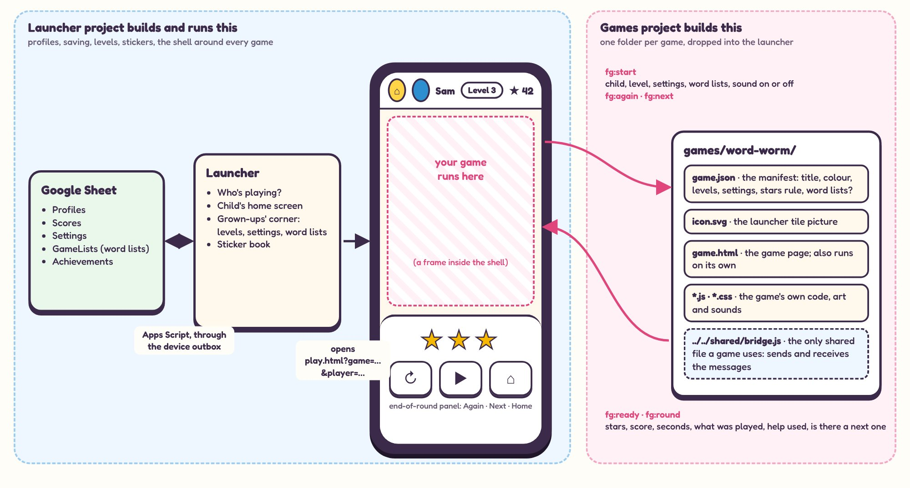

# Integration: how a game plugs into the launcher

> **The contract itself is now `docs/game-contract.md` (version 0.1, 2026-11-08).** This page is the longer background it came from. Where the two differ, the contract wins.

The rules a game follows so the launcher can run it, save its rounds, set its level and reward the child. Each rule is marked:

- **Decided**: Rob has adopted it. The source is in brackets: a launcher decision (P-number in `docs/PLAN.md`) or one of Rob's answers in `docs/review/REVIEW.md` (Q-number, 2026-10-30).
- **Proposed**: not decided yet. Most come from the launcher's review (its item code in brackets, such as G1); the rest are new in this pack and marked "new". Until Rob adopts them, treat them as the working assumption and expect small changes.



## 1. The basics

| Rule | Status |
|---|---|
| Plain HTML, CSS and JavaScript (ES modules). No build step, no frameworks, no packages at run time. | Decided (P1) |
| The site is static, on GitHub Pages. A game can't run server code. | Decided (P2) |
| Devices: an Android phone (Chrome) and a Windows PC. Test at 390×844 (phone upright), 844×390 (phone sideways) and 1366×768 (PC). No iPhone checks needed. | Decided (Q14); the upright and PC sizes are the review mockups', sideways is added here |
| Children are shown by first name or nickname and a cartoon animal. A game never asks for or stores anything else about them. | Decided (P9) |
| The repo is public: no real names or family details in any file, test or screenshot. Tests use made-up names. | Decided (project rule) |
| Comment the code so a grown-up can follow it; comments cite decision codes. | Decided (project rule) |
| Stars are the headline result: 1 to 3 a round. Stars are the points; nothing ever takes stars away. | Decided (P17); "never taken away" from the review, area 8 |
| Every reward the launcher gives is a **sticker**, in one sticker book. | Decided (Q16) |

## 2. The game shell

Every game runs inside one wrapper page, the **game shell**, which the launcher project builds. (Decided, Q10.)

- **A slim bar** at the top: home, the child's face and name, their level (for games with levels), and their stars. The game doesn't draw its own home button inside the shell.
- **The game, in a frame** under the bar. It's the whole width and the rest of the height.
- **One end-of-round panel**, drawn by the shell. It shows only what applies: stars if the game gives stars, what was played if the game reports it, **▶ Next** only when the game says there's a next one, **↻ Again** if it can restart, and **⌂ Home** always. On a phone it covers the lower part of the screen; on a PC it's a strip along the bottom, centred and only as wide as its contents. The game doesn't draw its own end card inside the shell.
- **The manifest says how the game is played:** `"play": "rounds"` (these three games) or `"play": "free"` (no end-of-round panel).
- The bar is about 55 px on a phone (the review's mockup measured 6% of the height). Design the game for the space that's left.

The shell itself is not built yet (the launcher's phase C). Until it is, use `contract/fake-shell.html`.

## 3. A game's folder

| File | What it is | Status |
|---|---|---|
| `games/<id>/game.json` | The manifest (section 4). The folder name is the game's id: lower case letters, numbers and `-` only. | Proposed (G1) |
| `games/<id>/icon.svg` | The launcher tile picture: original, simple, readable at 64 px, in one colour (`currentColor`) like the launcher's own icons. | Proposed (G6) |
| `games/<id>/game.html` | The game's page. | Proposed (G1) |
| `games/<id>/*.js`, `*.css` | Everything else the game needs: its own code, art, sounds and speech. | Proposed (new) |
| `../../shared/bridge.js` | **The only launcher file a game imports.** It sends and receives the messages in section 5. | Proposed (G2) |
| `tools/tests/games/` | The game's test (section 9), in the games project's test folder. | Proposed (new); the folder is P-034's, from its kick-off |

**A game carries its own sounds and speech code** (a copy of the prototype's `sound.js` is fine). It doesn't import the launcher's other shared files, so that the launcher can change without breaking games, and the game still runs on its own. (Proposed, new.)

**Adding a game never edits launcher code:** the launcher project adds one line to `games.json` (order and status) and nothing else. (Proposed, the review's target.)

## 4. The manifest: `game.json`

Proposed (G1, with the additions marked "new"). Example for Rocket Lander:

```json
{
  "title": "Rocket Lander",
  "colour": "#5B4FCF",
  "icon": "icon.svg",
  "page": "game.html",
  "play": "rounds",
  "levels": 8,
  "lists": null,
  "settings": {
    "speak":  { "default": true, "about": "Say the target out loud (when sound is on)" },
    "speed":  { "default": null, "min": 1, "max": 5, "about": "Leave blank to follow the level. 1 slow, 5 fast" },
    "landings_per_round": { "default": 8, "min": 3, "max": 20, "about": "Landings in one round" }
  },
  "stars": "3 for 85% or more right, 2 for 60% or more, otherwise 1",
  "score": { "counts": "right landings plus perfect ones", "better": "higher" },
  "subject": "numbers",
  "next": "the next planet, once it's unlocked"
}
```

| Field | Meaning | Status |
|---|---|---|
| `title`, `colour`, `icon`, `page` | The tile and the page to open | Proposed (G1) |
| `play` | `rounds` or `free` | Decided (Q10) |
| `levels` | How many levels the game has; `0` if none | Proposed (G1, S1) |
| `lists` | `"words"` if the game uses the child's word lists, else `null` | Proposed (new; the blueprint wrote `"settings": ["word-lists"]`) |
| `settings` | The grown-up settings, each with a default, limits or options, and a one-line `about`. `"default": null` means "follow the level". The launcher can build Game setup controls from this. | Proposed (new; the blueprint listed only names) |
| `stars` | The star rule in words, shown to grown-ups | Proposed (G1) |
| `score` | What the score counts, and whether higher or lower is better | Proposed (G1) |
| `subject` | `words`, `numbers` or another single word, for grouping games later | Proposed (G1) |
| `next` | What ▶ Next means in this game, in words | Proposed (new) |

Keep settings few. **Levels are the main way difficulty changes;** a setting is for what a level can't know, such as switching speech off for a child who reads. (Proposed, new; it follows Q5 to Q7 and Q17.)

## 5. The messages between the game and the shell

The game and the shell talk with `window.postMessage`. Every message is a plain object with a `type` starting `fg:` and a version `v: 1`. `bridge.js` hides the details. (Proposed: the two-message idea is the review's G2; the names and fields are new and need Rob's OK.)

**The game tells the shell**

| Message | When | Fields |
|---|---|---|
| `fg:ready` | The game has loaded and is listening | none |
| `fg:round` | A round has ended | `stars` 0 to 3 (required); `score`, `seconds`, `detail` (what was played, in words, such as "Week 3 spellings" or "0 to 20 in fives"), `help` (a number: hints, peeks or similar), `next` (true if there's a next one), `again` (false if it can't restart) |
| `fg:state` | Only if GQ2 is answered a: the in-game state changed | `state`: a small object, under 20,000 characters as JSON |

**The shell tells the game**

| Message | When | Fields |
|---|---|---|
| `fg:start` | After `fg:ready`, and again for ↻ Again and ▶ Next | `round`: `first`, `again` or `next`; `player`: `{ name, animal, colour }`; `level` (or `null`); `settings` (only the ones a grown-up set, already checked against the manifest); `lists` (the child's word lists for this game, the default first: `[{ title, words }]`); `sound` (true or false); `state` (GQ2 answer a) |

Rules for both sides:
- **Stars 0** means "finished with the answer shown". It's saved for the grown-ups and earns nothing. (Proposed, the review's blueprint.)
- `fg:round` is sent **once per round**. The shell then saves it, works out level-ups and stickers, and shows the panel. Level-ups are celebrated by the shell, not the game.
- The shell and the game are on the same site; each side ignores messages from anywhere else.

## 6. Running on its own (standalone)

Proposed (G2): **a game still works as a plain page or a claude.ai artifact, with no shell.**

- If the page isn't in a frame, or no `fg:start` arrives within about 1.5 seconds of `fg:ready`, the game runs **standalone**: level 1 (or `?level=` in the address), default settings, its own built-in word list, sound on, and nothing saved.
- Standalone, the game shows **its own small end card** with Play again, because there's no shell panel. Inside the shell it never does.

## 7. Levels, settings and word lists

| Rule | Status |
|---|---|
| A game with built-in difficulty has levels. A grown-up sets each child's starting level. | Wanted by Rob (Q5 to Q7); the details are proposed (S1) |
| The launcher moves a child up after three 3-star rounds in a row at a level, and never moves them down by itself. The game doesn't decide levels. | Proposed (S1) |
| The game maps each level to its own difficulty, in its code, and documents the table in its `DESIGN.md`. | Proposed (new) |
| A grown-up setting beats the level for that one thing. Blank means "follow the level". | Proposed (new) |
| Per-child settings are stored in one general **Settings** tab (profile_id, game_id, key, value, updated_at). | Decided: one general tab (Q12); its columns are proposed (D1) |
| Word lists stay in the **GameLists** tab, set up by a grown-up in Game setup. The shell hands the child's lists to the game; the first is the default. | Decided (Q12); GQ3 asks whether word games share one set |
| Word lists are lists, not levels. | Decided for Kriss Kross (Q17); assumed for Word Worm |
| A list from GameLists can contain anything a grown-up types. The game cleans it: lower case, letters only, no repeats, and it copes with a list of one word or a hundred. | Proposed (new) |

## 8. Sound, speech and the first tap

| Rule | Status |
|---|---|
| Read things aloud for children who can't read yet, behind the sound switch: when the shell says `sound: false`, the game makes no sound and says nothing. | Decided (Q15) |
| Every spoken prompt is also shown on screen, with a speaker button to hear it again. A game works fully on a device with no voice. | Proposed (new; the prototypes already do this) |
| Speech uses the browser's built-in voice, `en-GB` when there is one. Speech synthesis was "widely available" across browsers when checked on 2026-10-29 (web-features explorer, "Speech synthesis"); check again when it matters. | Proposed (new) |
| **The first screen has a big Play button.** Chrome on Android only lets a page play sound after a tap on that page, and the tap on the launcher's tile was on a different page. Again and Next skip the Play screen. | Proposed (new; how Chrome handles this needs checking on the phone) |

## 9. Testing before hand-over

A game is ready to hand to the launcher project when all of these pass. (Proposed, new.)

1. It plays a full round in `contract/fake-shell.html` at 390×844, 844×390 and 1366×768, with no console errors.
2. It sends exactly one `fg:round` per round, with the fields above, and starts again correctly on ↻ Again and ▶ Next.
3. Every level in its table plays, and a grown-up setting overrides its level.
4. With `sound: false` it makes no sound and says nothing.
5. It works standalone (section 6), and as a claude.ai artifact if the game is ever shared that way.
6. An automated test (Playwright, like the prototypes' tests) plays at least one round through the fake shell and checks the messages.
7. No names or family details anywhere in the folder or the test.
8. Its `DESIGN.md` is up to date: level table, star rule, what Next means, known issues.

The launcher project then adds it with status `testing`, so Rob can play it on the real phone before the children see it (proposed, G5).

## 10. Moving a prototype onto the contract

The checklist for each of the three games. (Proposed, new.)

1. Rename `index.html` to `game.html`. Add `game.json` (section 4) and `icon.svg`. The prototypes' tile pictures are in `prototype/shared/icons.js` (`g-worm`, `g-cafe`, `g-rocket`).
2. Copy `prototype/shared/sound.js` into the game's folder and change its import of `api.js` (used only to remember mute) to the shell's `sound` flag.
3. Replace the imports from `shared/game-kit.js` and `shared/settings.js`:
   - `getPlayer()` → `start.player`
   - `loadSettings()` / `settingsNow()` → the level table plus `start.settings`
   - `settings.word_list` → `start.lists`
   - `record()` / `finish()` → `fg:round`
   - `loadProgress()` / `saveProgress()` → `start.state` and `fg:state` (GQ2)
   - `homeButton()` → nothing: the shell has the home button
4. Turn the game's `settings.js` into the level table (in its `DESIGN.md`) plus the few settings that stay, listed in `game.json`.
5. Keep the game's own end card and Play button for standalone; skip the end card inside the shell.
6. Report `detail` and `help` with each round (each game's `DESIGN.md` says what they are).
7. Rewrite the test to play through the fake shell. The prototypes' tests use a stand-in Sheet (`prototype/tools/tests/standin.py`); the new tests don't need one.

## Not decided yet

From the launcher project, and worth knowing before building:

- **The shell** is approved in principle (Q10) but not built; how it behaves in a frame on the children's phone (touch, sound, full height) is still to be tried (the review's "G2 trial").
- **The manifest fields** (G1), the **Settings tab's columns** and script 0.4.0 (D1), **levels** (S1) and the **sticker book** (S3) are all proposed.
- **What free play counts towards** is TBC, decided with the first free-play game (Q10). None of these three is free play.
- **In-game unlocks as stickers:** the sticker book plans one page per game, made from its manifest (S3). Whether a game's own unlocks (hats, decorations, planets) also appear there is open.
