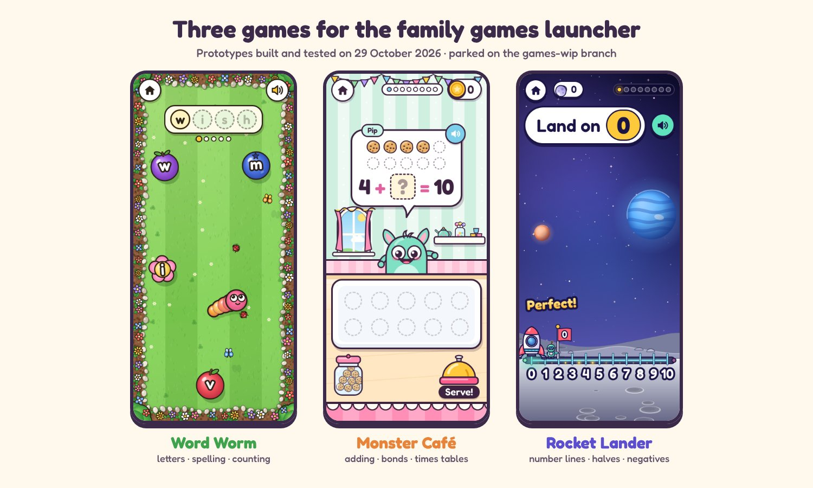
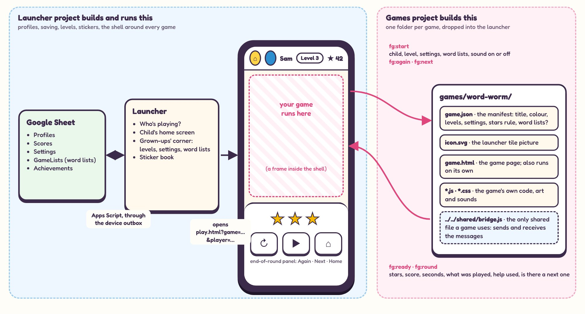

# Games pack: Word Worm, Monster Café, Rocket Lander

A hand-over pack for a separate games project. That project develops these three games. The launcher project (this repo's `work` branch) keeps the launcher, profiles, saving, stickers and the game shell that every game runs inside.

Made 2026-11-08 from the parked prototypes on the `games-wip` branch (commit `7ef1ff0`, built and tested 2026-10-29).



## What's inside

| File | Read it for |
|---|---|
| `README.md` | This page: status, who does what, open questions, first steps |
| `INTEGRATION.md` | **The rules a game must follow to plug into the launcher**, marked decided or proposed |
| `DESIGN-GUIDE.md` | How every game should look, sound and feel |
| `word-worm/DESIGN.md` | Word Worm: how it plays, settings, levels, rewards, ideas, known issues |
| `monster-cafe/DESIGN.md` | Monster Café, the same |
| `rocket-lander/DESIGN.md` | Rocket Lander, the same |
| `*/screens/` | Screenshots from the prototype, phone and PC |
| `contract/` | Draft `bridge.js` (the messages between a game and the shell), a fake shell to test with, and a tiny example game |
| `prototype/` (zip only) | The working prototype code of all three games, runnable on a laptop |
| `images/` | The cover and the "how a game plugs in" diagram |
| `build/` (repo only) | `make-pack.sh`, which builds this zip from the repo, and the sources of the pictures |

## Where the games stand

| Game | Learning | Prototype | Tested | On the live site |
|---|---|---|---|---|
| Word Worm | Letters, spelling, counting in steps | Complete and playable | Phone and PC sizes, every mode, against a stand-in Sheet | No |
| Monster Café | Adding, taking away, bonds, doubles, halves, times tables, sharing | Complete and playable | Phone, phone sideways and PC, every sum type | No |
| Rocket Lander | Number lines: whole numbers, halves, negatives, up to 100 | Complete and playable | Phone, phone sideways and PC, every setting | No |

All three were tested in a headless browser only, most recently on 2026-11-08, when every test passed again and the screenshots in this pack were taken. None has been played on a real phone or with a real voice yet.

**The prototypes are built for an older launcher design and don't plug into today's launcher as they are.** They import the launcher's shared files and read settings from a Sheet layout that was never adopted. `INTEGRATION.md` lists what changes ("Moving a prototype onto the contract").

## Who does what



| Games project | Launcher project |
|---|---|
| Each game's folder: `game.json`, `icon.svg`, `game.html` and its own code, art and sounds | The game shell (`play.html`), the bar and the end-of-round panel |
| Levels inside the game: what level 1, 2, 3… mean | Which level each child is on, and moving up |
| Reporting each round (stars, score, what was played, help used) | Saving to the Sheet, stars, stickers, skins, celebrations |
| Its own tests, played through the fake shell | The real `bridge.js`, Game setup screens, the Sheet and Apps Script |

The two projects meet at one place: the contract in `INTEGRATION.md`. A change to it is agreed by Rob and made in both.

## Open questions (TBC, for Rob)

Each has a recommendation, marked as mine. Nothing here is decided until Rob says so.

| # | Question | Options (recommended first) |
|---|---|---|
| GQ1 | Where does the games project keep its code? | **Settled at the kick-off of P-034 (Kids Games Development), 2026-11-08:** this repo, branch `claude/games`. P-034 writes only `games/`, `games.json`, `docs/games/` and `tools/tests/games/`; P-020 (Family Games Launcher) keeps out of those. |
| GQ2 | Where do in-game unlocks and coins live (worm hats, café decorations and coins, planets and moon rocks)? | **a. The game keeps a small state object; the shell saves it per child per game in the Settings tab and hands it back at the start** (my recommendation: simple, works for buying things, follows Q12's "one general Settings tab for everything new") · b. Worked out from Scores only, so nothing can be bought: decorations unlock at coin totals instead · c. Kept on the device only, so lost on another device |
| GQ3 | Word lists for Word Worm: its own, or shared with Kriss Kross? | **a. One set of spelling lists per child, used by every word game** (my recommendation: the weekly spellings are typed once) · b. Each game has its own lists in GameLists, with a "copy to another game" button |
| GQ4 | Counting in Word Worm: a mode inside Word Worm, or its own tile? | **a. Keep it a mode a grown-up switches on** (my recommendation: no new tile, and levels stay about spelling) · b. A second tile, "Number Worm", from the same folder |
| GQ5 | Which game first? | **a. Rocket Lander** (my recommendation: no word lists, simplest settings, so it tests the shell and levels with the fewest moving parts) · b. Word Worm · c. Monster Café |

The launcher's own open questions that affect games are listed in `INTEGRATION.md`, "Not decided yet".

## Suggested first steps for the games project (proposed)

1. Rob answers GQ2 to GQ5 (GQ1 is settled).
2. The launcher project finishes the shell and the real `bridge.js` (its phase C). Until then, the games project works against `contract/fake-shell.html` and the draft `contract/bridge.js`.
3. Move the first game onto the contract: manifest, `game.html`, bridge, levels, its own sounds. `INTEGRATION.md` has the checklist.
4. Play it in the fake shell, then hand it to the launcher project as a folder. The launcher project adds it as `testing`, so Rob can try it on the phone before the children see it.
5. Repeat for the other two.

## Running the prototype (zip only)

```
cd prototype
python3 -m http.server 8000
```

Then open http://localhost:8000/ and pick a game. With no player picked, the games use their default settings and save nothing. The link to the family's Apps Script has been taken out of `prototype/shared/config.js`, so nothing reaches the real Sheet.

## Draft instructions for the new project (proposed)

Written before P-034 (Kids Games Development) was set up; P-034 now has its own instructions, so this is for reference only.

```
## Family games: game development

This project develops games for the family games launcher (repo RobL89/family-games).
The launcher project owns the launcher, saving, stickers and the game shell.
This project owns the game folders.

### Start of every chat
1. Read handoff.md.
2. Add RobL89/family-games to the chat and clone it with --branch claude/games.

### Rules
- I decide. Label suggestions as proposed until I agree; close each as adopted or declined.
- Never invent facts or figures; write TBC and ask.
- Follow INTEGRATION.md and DESIGN-GUIDE.md from the games pack. A change to the contract
  needs my OK and a note to the launcher project.
- One folder per game, nothing outside it except tests. Never edit the launcher's files.
- The repo is public: no names or family details in it.
- Plain HTML, CSS and JavaScript, no build step. Comment the code; cite decision codes.
- Test every game in the fake shell at phone and PC sizes before hand-over.
- Push to the games branch after each stage. Never push to main.
```

## Where this came from

- The game ideas: chat of 2026-10-29, built the same day on `games-wip`.
- The launcher decisions quoted in `INTEGRATION.md`: `docs/review/REVIEW.md` on `work` (pass 2, Rob's answers of 2026-10-30) and the project handoff of 2026-11-01.
- The proposals from `games-wip` (its P40 to P46) are carried over with new codes in each game's `DESIGN.md` (WW-, MC-, RL-), because their P-numbers clash with the launcher's.
