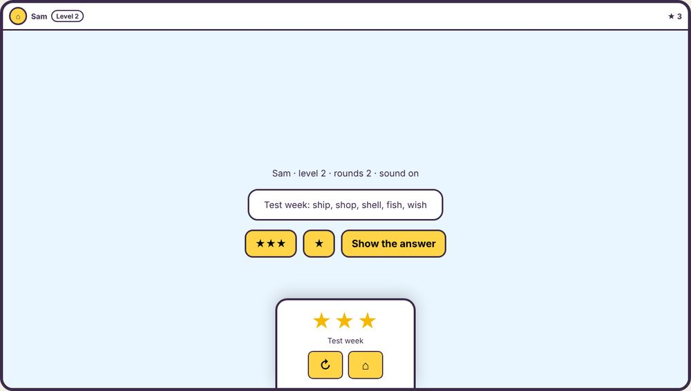

# Contract files (draft)

Working drafts of the contract in `../INTEGRATION.md`, so a game can be built and tested before the launcher's real shell exists. All **proposed**; the launcher project owns the final versions.

| File | What it is |
|---|---|
| `bridge.js` | The game's side of the messages. In the real launcher it will be `shared/bridge.js`. |
| `fake-shell.html` | A stand-in for the shell: a bar, the game in a frame, the end-of-round panel, a message log, and boxes to set the player, level, settings, word lists, sound and saved state. |
| `example/` | The smallest game that follows the contract: `game.json`, `icon.svg`, `game.html`. |
| `test_example.py` | Plays the example through the fake shell at phone, sideways and PC sizes, and standalone. A pattern for each game's own test. |

**Try it**

```
cd docs/games-pack            (or the unzipped pack)
python3 -m http.server 8150
```

Then open http://localhost:8150/contract/fake-shell.html?game=example/game.html

The address can also set `size` (`390x844`, `844x390`, `1366x768`), `level`, `sound=0`, `settings` and `lists` (both as JSON).

**Test it** (needs Python Playwright): `python3 contract/test_example.py 8150`. It ended "PASS 26 of 26" on 2026-11-08.


