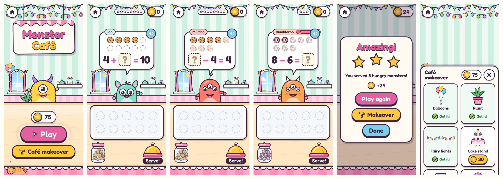
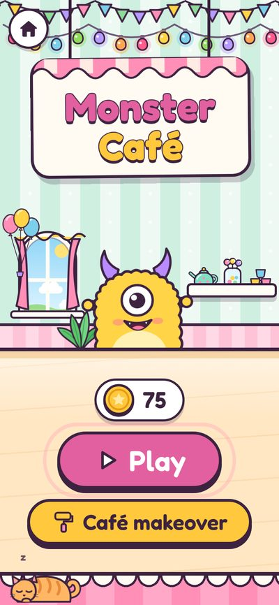
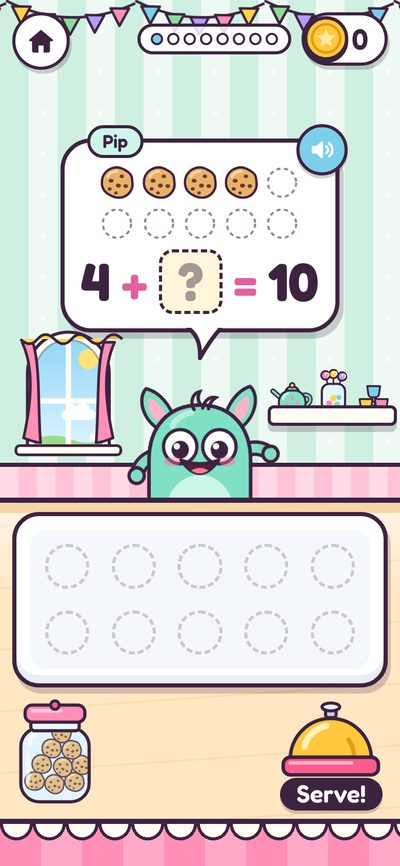
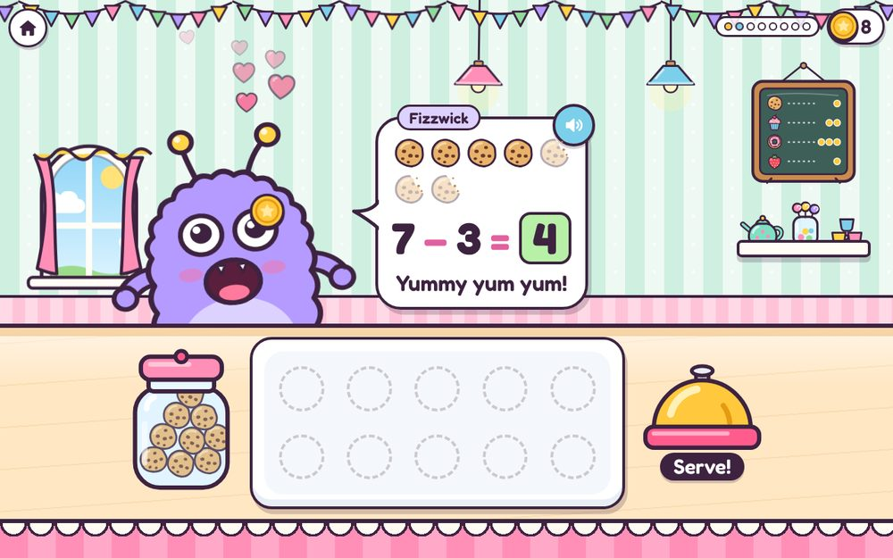
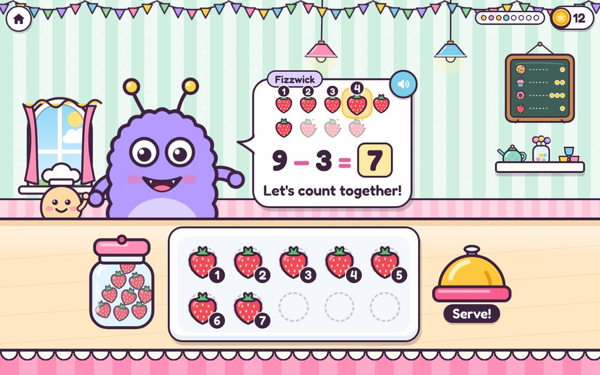
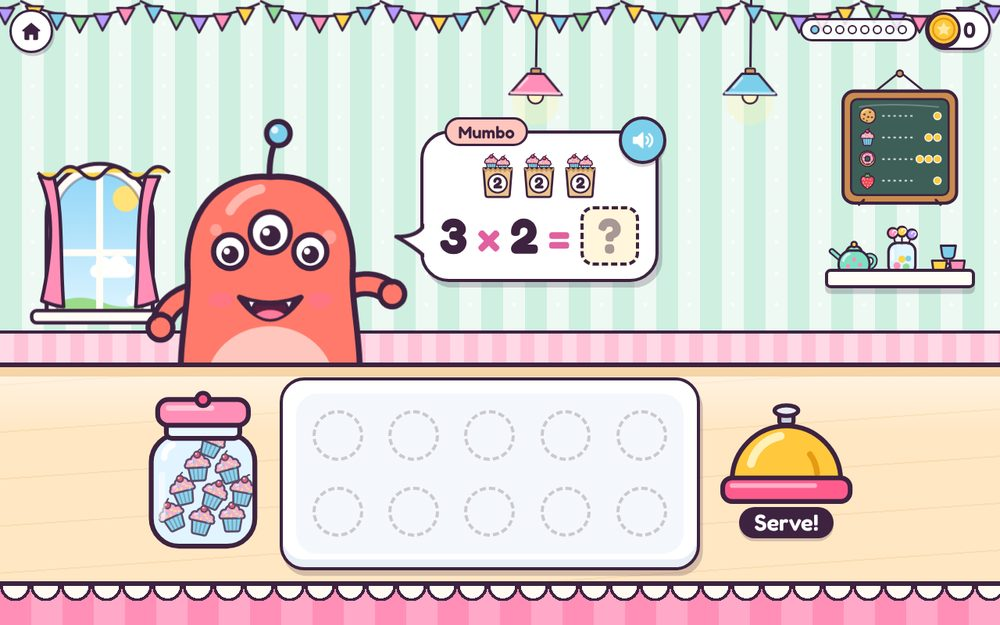
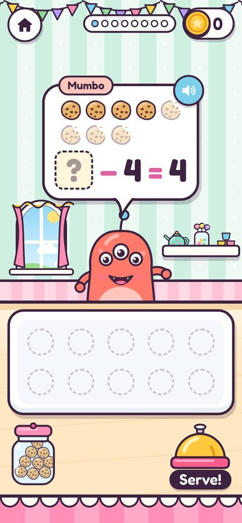
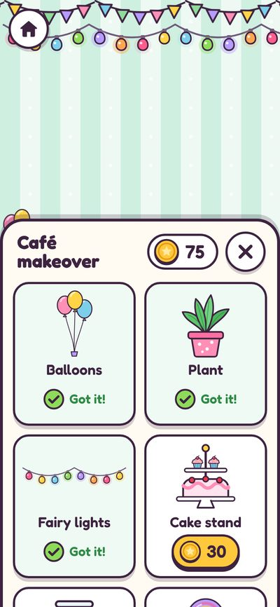

# Monster Café

**Hungry monsters queue at a café counter with orders that are little sums.** The child serves the right amount, earns coins and spends them doing up the café.

- **Practises:** counting, adding, taking away, number bonds, doubling, halving, times tables and sharing, with or without pictures.
- **Subject:** numbers.
- **Prototype:** complete, on `games-wip` (commit `7ef1ff0`), in the zip's `prototype/games/monster-cafe/`.

## How it plays

1. The start screen shows the café as the child has decorated it, the coin jar total, a Play button and the "Café makeover" shop.
2. A monster slides up to the counter. Its order is in a speech bubble, with food pictures and the sum in big numbers ("7 − 2 = ?"), and is said out loud.
3. The child answers by:
   - **tapping:** each tap on the jar hops one item onto the tray, with number badges 1, 2, 3…; tap an item on the tray to take it back; ring the bell to serve;
   - **number pad:** big keys 0 to 9, Clear and Serve, for bigger answers.
4. **Right:** the monster eats (crumbs fly), dances, hearts float up, and coins fly into the jar.
5. **Wrong:** the monster is puzzled ("Hmm, that's 4. I wanted 5!"). After a second wrong try a helper counts along, lighting up the pictures one by one. After a third, the monster kindly shows the answer and leaves happily.
6. **End of the round:** stars, coins earned, and the way into the shop.

| | |
|---|---|
|  |  |
|  |  |

## The monsters and the food

- **Eight original monsters,** built from SVG parts (body shape, one to three eyes, horns, antennae, spots, teeth): Gloop, Fizzwick, Bumbleroo, Snorkel, Wobbla, Grumbletum, Pip and Mumbo. They bob, blink and react.
- **Four foods:** cookies, cupcakes, doughnuts and strawberries. Each order uses one; it changes from order to order.

## Kinds of order

| Kind | Example | Shown as |
|---|---|---|
| add | "3 cookies and 2 more, please!" | 3 + 2 = ? |
| take | "I had 5 cookies and ate 2. How many are left?" | 5 − 2 = ? |
| bonds | "I've got 7. Make it up to 10!" | 7 + ? = 10 |
| double | "Double 4, please!" | double 4 = ? |
| half | "Half of 8, please!" | half of 8 = ? |
| times | "3 bags of 5" | 3 × 5 = ? |
| share | "Share 12 between 3 friends. How many each?" | 12 ÷ 3 = ? |
| missing number | sometimes, for add, take and times | ? + 3 = 7 |

Orders mix evenly, never repeat twice in a row, and every number stays within the maximum. Above 20, the pictures switch to boxes of ten.

| | |
|---|---|
|  |  |

## The prototype's settings

From `prototype/games/monster-cafe/settings.js`. On the new contract, most become the level table below.

| Setting | Default | Range or options | Does |
|---|---|---|---|
| `speak` | on | on or off | Say orders out loud |
| `sums` | add, take | add, take, bonds, double, half, times, share | Kinds of order |
| `max_number` | 10 | 3 to 100 | Biggest number anywhere in an order |
| `bond_to` | 10 | 2 to 100 | The number to make, for bonds (capped at `max_number`) |
| `tables` | 2, 5, 10 | 1 to 12 | Times tables for times and share |
| `answer_with` | auto | auto, tap, pad | auto taps for answers up to 10, pad above; pad always above 20 |
| `pictures` | on | on or off | Food pictures in the orders |
| `missing_number` | off | on or off | Sometimes ask "? + 3 = 7" |
| `orders_per_round` | 8 | 3 to 20 | Orders in one round |
| `patience` | 0 | 0 to 120 seconds | A heart meter that drains; 0 = no meter |

## Levels (proposed, my judgement)

| Level | Kinds | Up to | Answer with | Pictures | Missing number |
|---|---|---|---|---|---|
| 1 | add | 5 | tap | yes | no |
| 2 | add, take | 10 | tap | yes | no |
| 3 | bonds to 10 | 10 | tap | yes | no |
| 4 | add, take | 20 | auto | yes | no |
| 5 | double, half | 20 | auto | yes | no |
| 6 | add, take | 20 | pad | no | yes |
| 7 | times (2, 5, 10) | 50 | pad | yes | no |
| 8 | times, share (2, 3, 4, 5, 10) | 60 | pad | no | yes |

`patience` stays a grown-up setting, off by default: a timer is stressful for the youngest.

## Stars, score and what's reported

| | Prototype | On the contract |
|---|---|---|
| Stars | Right first time on 85% or more of orders: 3 · 60% or more: 2 · otherwise 1 (MC-1) | The same |
| Score | Coins earned this round: 3 for right first time, 1 after a retry, 0 if the answer was shown or the monster left (MC-1) | The same; `better: higher` |
| `detail` | n/a | The kinds and range, such as "add and take to 20" (proposed) |
| `help` | n/a | Orders where the helper counted along or the answer was shown (proposed) |
| ▶ Next | n/a | None: ↻ Again only (proposed) |

## Rewards inside the game

- **Coins** in a jar, spent in the **Café makeover** shop on nine decorations that then appear in the café:

| Decoration | Coins | | Decoration | Coins |
|---|---|---|---|---|
| Balloons | 10 | | Jukebox (plays a tune when tapped) | 50 |
| Plant | 15 | | Neon heart | 60 |
| Fairy lights | 20 | | Sleepy cat | 80 |
| Cake stand | 30 | | Chandelier | 100 |
| Fish bowl | 40 | | | |

- **Monsters served,** counted per monster.
- Saved in the prototype as `{ coins, owned, served }`; where it lives on the contract is GQ2. Buying needs somewhere to save (GQ2 answer a).

## Sounds and speech

- Sounds: whoosh (a monster walks in), hello (a greeting, and the helper arriving), pop (food onto the tray, ringing the bell, coins popping out, counting along), chomp (eating), ding (right), coin (each coin into the jar), boop (wrong, or not allowed), puff (clearing the pad), sparkle (the answer shown kindly), unlock (buying a decoration), soon (a monster leaves when patience runs out), tap (buttons), and a jukebox tune of its own.
- Speech: a greeting with each order ("Hi there! I'm Pip. 3 cookies and 2 more, please!"), counts as items land on the tray, the reactions, and the helper counting along.

## Ideas to develop (proposed)

- **Paying with money:** the monster pays with coins (1p, 2p, 5p, 10p) and the child counts them, or gives change.
- **Telling the time:** "I'll be back at 3 o'clock", with a clock to set.
- **Fractions by cutting:** half a pizza, a quarter of a cake; tap to cut.
- **More or less:** "Give me more than 5 cupcakes, but fewer than 8."
- **Two-food orders:** "2 cookies and 3 doughnuts", then "how many altogether?"
- **Monster cards:** serve a monster 10 times to fill in its card (favourite food, home, a funny fact).
- **Birthday orders:** now and then, a party order with a cake, candles to count and a song.

## Known issues and carried-over proposals

| Code | What | Status |
|---|---|---|
| MC-1 | The star and coin rules above | Proposed (was P41 on `games-wip`) |
| MC-2 | A times table is only used if at least two of its answers fit under `max_number`. With the defaults (2, 5, 10 up to 10), the 10 times table never comes up. Say so in the setting's help | Proposed (was P46) |
| MC-3 | `bond_to` is capped at `max_number`. Say so in the setting's help | Proposed (was P46) |
| MC-4 | Answers are never 0: no "5 take away 5", so a tray is never served empty on purpose | Proposed (was P46) |
| MC-5 | The decorations and prices above | Proposed (was P44) |

## Code map (prototype)

| File | Does |
|---|---|
| `index.html`, `game.css` | The page: café scene, counter, tray, pad, cards, shop |
| `game.js` | Layout, rounds, serving, helper, coins, the shop |
| `orders.js` | Makes the orders for each kind, within the settings |
| `art.js` | The eight monsters, the four foods, the café scenery |
| `decor.js` | The nine decorations and their prices |
| `settings.js` | The settings above, in the old launcher's format |
