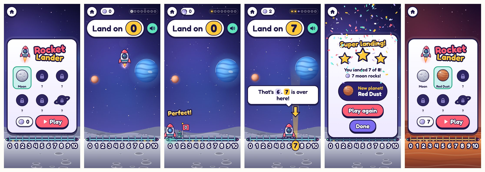
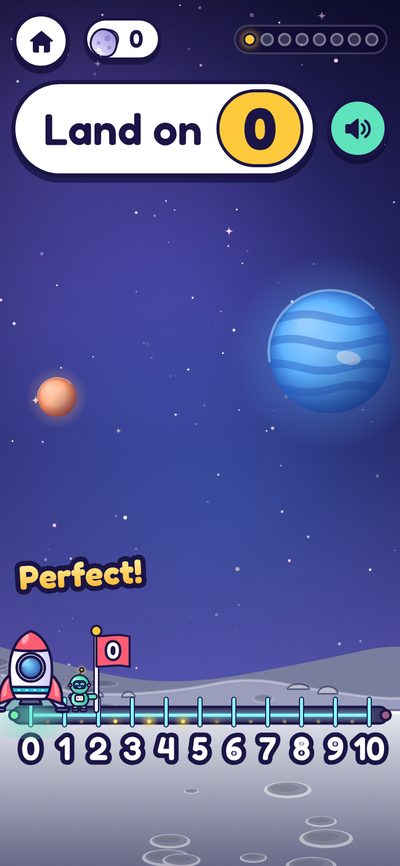
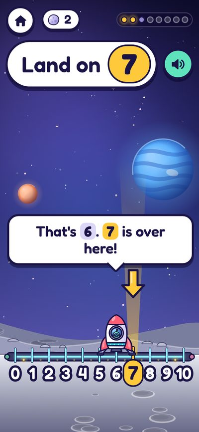
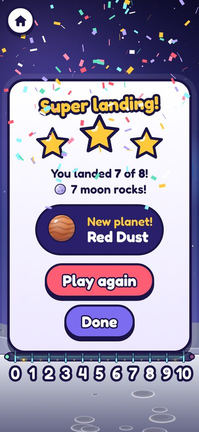
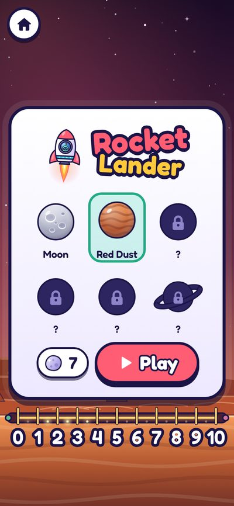
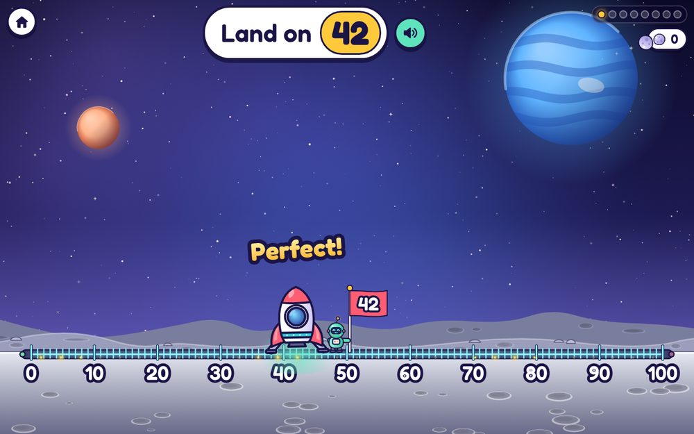
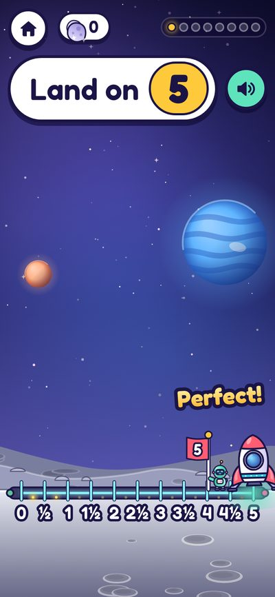
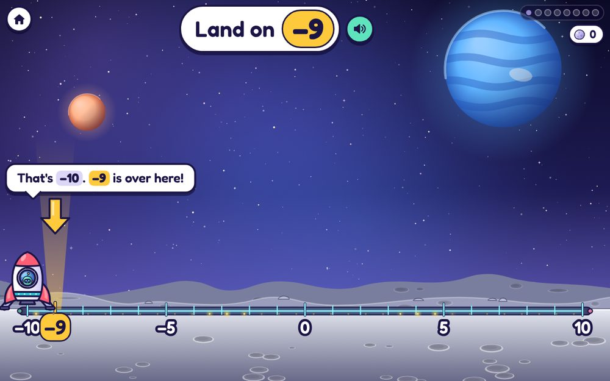
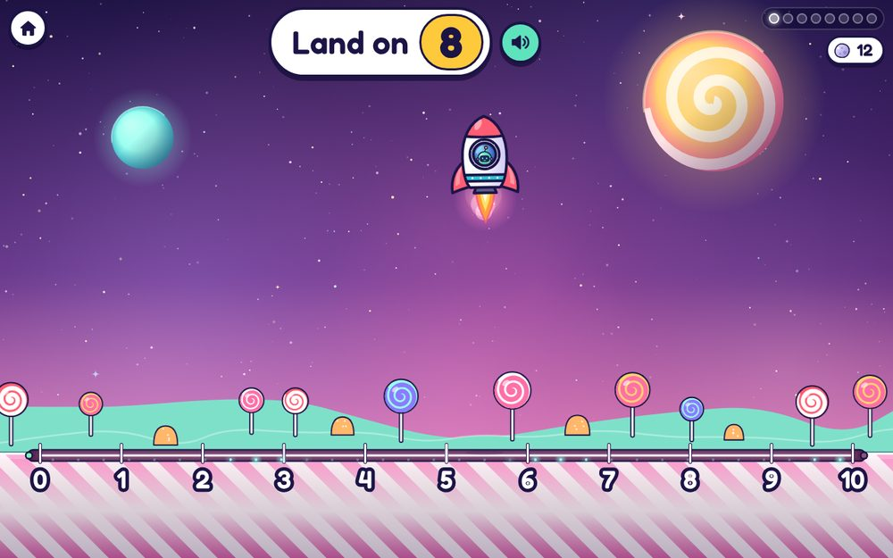
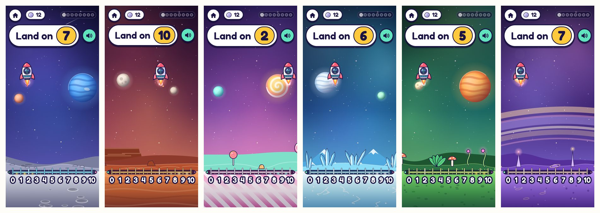

# Rocket Lander

**A little rocket drifts down towards a planet whose ground is a number line.** The child steers it to land on the target number. Good rounds unlock new planets; perfect landings earn moon rocks.

- **Practises:** where numbers sit on a line (0 to 10, then up to 100), estimating between marked numbers, halves and quarters, and negative numbers.
- **Subject:** numbers.
- **Prototype:** complete, on `games-wip` (commit `7ef1ff0`), in the zip's `prototype/games/rocket-lander/`.

## How it plays

1. The start screen shows the planet picker (unlocked planets bright, locked ones as dark shapes), the moon rock total and a Play button.
2. "Land on 7" appears at the top and is said out loud. The rocket starts high up, away from the target, and falls steadily.
3. The child steers it sideways:
   - **phone:** hold or drag anywhere and the rocket glides towards the finger;
   - **PC:** hold the mouse button, or use the arrow keys or A and D.
   Near the ground its legs pop out.
4. **Right:** a puff of dust, a bounce, and the robot pilot, Bip, hops out and plants a flag with the number. Very close to the middle is **"Perfect!"** and earns a moon rock.
5. **Wrong:** a soft, bouncy landing (never a crash). The right mark lights up with an arrow: "That's 6. 7 is over here!"
6. **End of the round:** stars, landings and moon rocks, and "New planet!" when one unlocks.

| | |
|---|---|
|  |  |
|  |  |

## The number line

- A mark at every `step`, a number under marks every `label_every`, and the two ends always labelled. If labels can't fit, it labels every 2nd, 5th or 10th so the spacing stays even.
- **Where the rocket touches down snaps to the nearest mark.** When marks are too close to aim at (under 24 px apart on screen), a landing counts within half a labelled gap; a faint glow shows that zone while steering. `close_enough` can widen it.
- Numbers are tidy: no rounding noise, a proper minus sign, and halves and quarters as 2½ or 2.5.
- Spoken the way a child says them: "two and a half", "minus three", "two point five".
- Odd settings are fixed sensibly: ends the wrong way round are swapped, and more than 400 marks makes the step bigger.

| | |
|---|---|
|  |  |
|  |  |

## The planets

Six original planets, each with its own ground, sky and decorations: **Moon** (grey, craters), **Red Dust** (rusty dunes), **Candy** (pink and white stripes, lollipops), **Ice** (blue crystals), **Jungle** (green, odd plants) and **Ringed** (purple, rings across the sky). A round with 2 or more stars unlocks the next one.

## The prototype's settings

From `prototype/games/rocket-lander/settings.js`. On the new contract, most become the level table below.

| Setting | Default | Range or options | Does |
|---|---|---|---|
| `speak` | on | on or off | Say the target out loud |
| `from` | 0 | −1000 to 1000 | Left end of the line |
| `to` | 10 | −1000 to 1000 | Right end of the line |
| `step` | 1 | 0.01 to 100 | Gap between landing spots: 1, 0.5, 0.25, 0.1, 10… |
| `label_every` | 1 | 0 to 500 | Label a mark this often; 0 = only the ends |
| `show_as` | fraction | fraction, decimal | 2½ or 2.5 |
| `close_enough` | 0 | 0 to 500 | How near counts; 0 = on the mark (long lines get leeway automatically) |
| `landings_per_round` | 8 | 3 to 20 | Landings in one round |
| `speed` | 2 | 1 to 5 | Time to fall: 12, 8, 6, 5 or 4 seconds |

## Levels (proposed, my judgement)

| Level | Line | Labels | Counts if | Speed |
|---|---|---|---|---|
| 1 | 0 to 5 | every number | on the mark | 1 |
| 2 | 0 to 10 | every number | on the mark | 1 |
| 3 | 0 to 10 | 0, 5, 10 | on the mark | 2 |
| 4 | 0 to 20 | every 5 | on the mark | 2 |
| 5 | 0 to 20 | the ends only | within 1 | 2 |
| 6 | 0 to 100 | every 10 | within 5 (automatic) | 2 |
| 7 | 0 to 5 in halves | whole numbers | on the mark | 2 |
| 8 | −10 to 10 | every 5 | on the mark | 3 |

`landings_per_round` stays a grown-up setting.

## Stars, score and what's reported

| | Prototype | On the contract |
|---|---|---|
| Stars | Right on 85% or more of landings: 3 · 60% or more: 2 · otherwise 1 (RL-1) | The same |
| Score | Right landings plus perfect ones | The same; `better: higher` |
| `detail` | n/a | The line, such as "0 to 20, labels every 5" (proposed) |
| `help` | n/a | Replays of the spoken target (proposed) |
| ▶ Next | n/a | The next planet, once it's unlocked (proposed) |

## Rewards inside the game

- **Planets,** unlocked one at a time by rounds with 2 or more stars; the child picks which to fly to. (RL-1)
- **Moon rocks,** one per perfect landing; the total shows on the start screen.
- **Landings,** counted all time.
- Saved in the prototype as `{ unlocked, planet, rocks, landings }`; where it lives on the contract is GQ2.

## Sounds and speech

- Sounds: whoosh (take-off), pop (legs out near the ground), puff and thud (touchdown), ding (the flag goes in after a right landing), sparkle (perfect, a moon rock), boop (a miss, or a locked planet), levelup or yay (end of the round), unlock (new planet), tap (buttons).
- Speech: "Land on seven!", "two and a half", "minus three", and "That's 6. 7 is over here!"

## Ideas to develop (proposed)

- **Land on a sum:** "Land on 3 + 4", "Land on 10 more than 23", "Land on half of 8".
- **Rounding:** land on 37, then "Which ten is it nearest?", with the rocket hopping to 40.
- **Estimating:** only the ends labelled, and a gold flag for landing within one.
- **Clock planet:** a curved number line round a clock face, for telling the time.
- **Ruler planet:** land on 7 cm on a ruler, for measuring.
- **Thirds and fifths** for older children.
- **A space station** built piece by piece from moon rocks.
- **Pilot outfits** for Bip, unlocked by landings.

## Known issues and carried-over proposals

| Code | What | Status |
|---|---|---|
| RL-1 | The star rule above; a round with 2 or more stars unlocks the next planet | Proposed (was P42 on `games-wip`) |
| RL-2 | With step 0.5 and the default `label_every` of 1, only whole numbers get labels. Setting `label_every` to 0.5 labels the halves too | Note |
| RL-3 | On a phone, on −10 to 10, the highlighted label after a miss overlaps its neighbours (seen in the screenshots of 2026-11-08) | Open |
| RL-4 | The moon rock counter goes up a moment after "Perfect!", once the rock has flown to it | Note |

## Code map (prototype)

| File | Does |
|---|---|
| `index.html`, `game.css` | The page: target bar, start card, end card |
| `game.js` | Steering, falling, landing, rounds, saving |
| `scene.js` | All the drawing: sky, ground, number line, rocket, Bip, flags, effects |
| `numbers.js` | Tidy numbers, fractions, words for speaking, how near counts, stars |
| `planets.js` | The six planets' colours and sky objects |
| `settings.js` | The settings above, in the old launcher's format |
