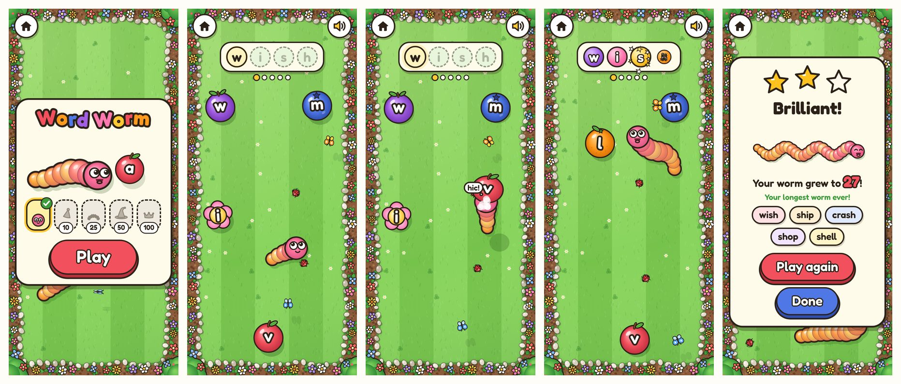
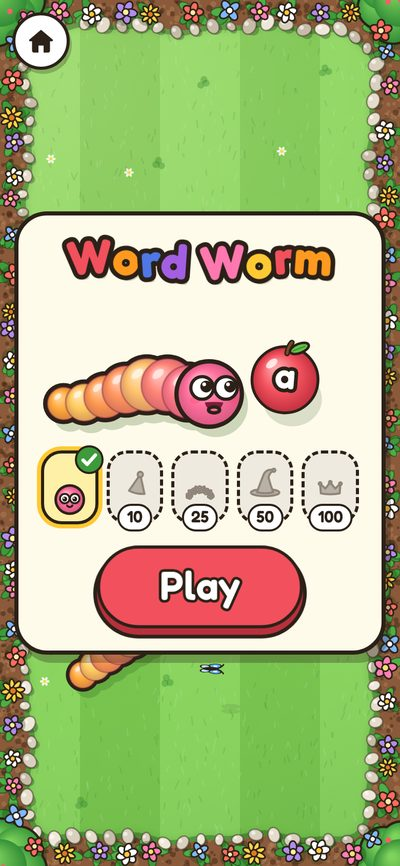
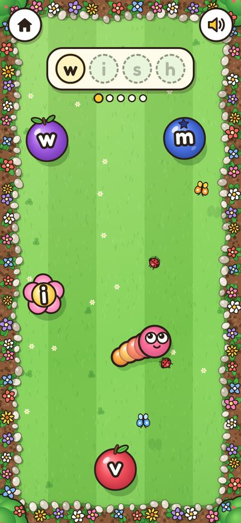
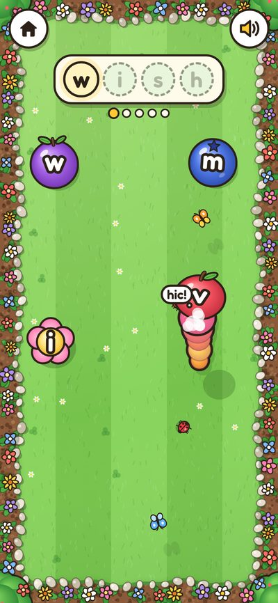
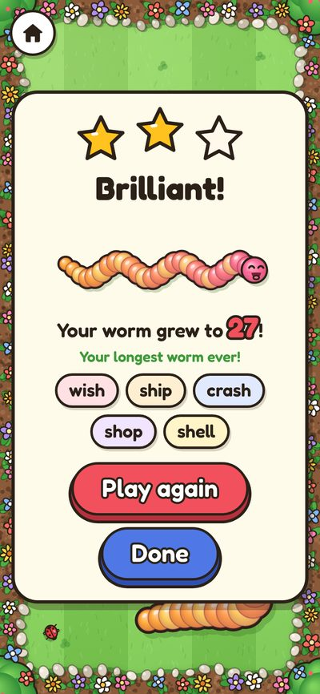
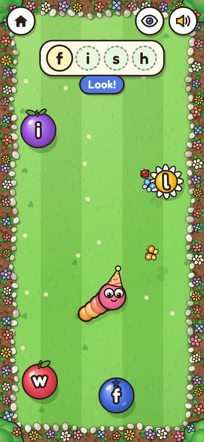
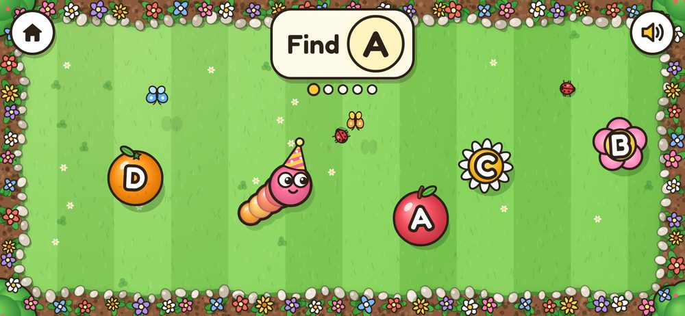
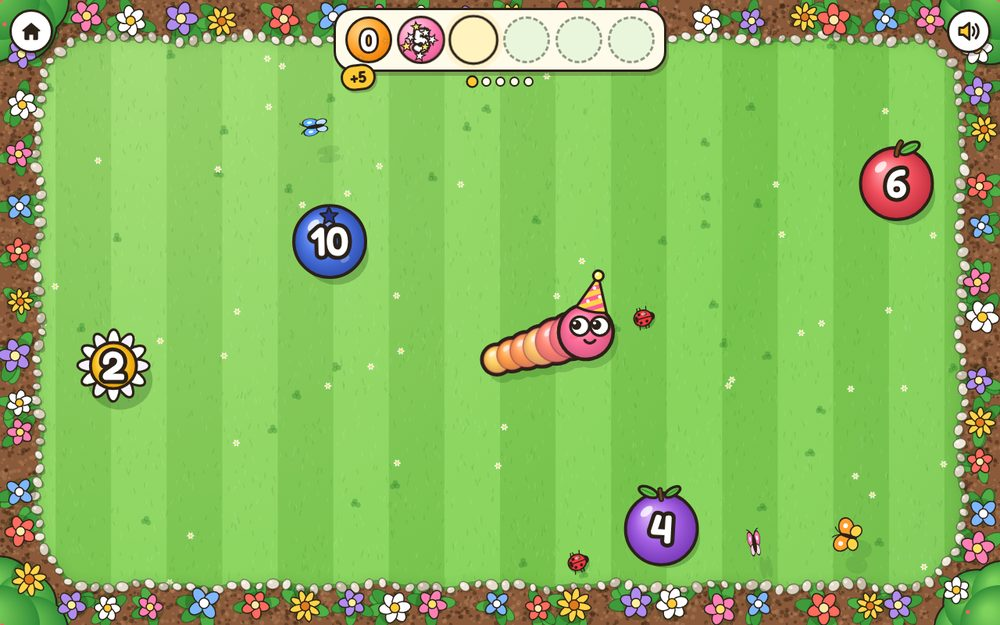
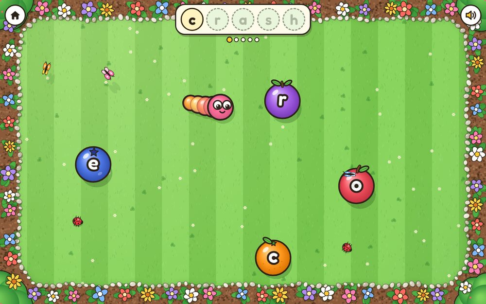

# Word Worm

**A hungry worm slithers round a sunny garden, eating letters in the right order to spell words.** Wrong letters give it hiccups. It grows with every bite and earns hats.

- **Practises:** finding letters, spelling the child's own word lists (look, cover, spell), and counting in steps.
- **Subject:** words (counting is a mode; see GQ4 in `../README.md`).
- **Prototype:** complete, on `games-wip` (commit `7ef1ff0`), in the zip's `prototype/games/word-worm/`.

## How it plays

1. The start screen shows the worm wearing its hat, a hat wardrobe (locked hats as grey shapes with the words still needed), and a big Play button.
2. The word bar at the top has one slot per letter. The worm moves forward on its own; the child steers it:
   - **phone:** hold a finger down and the head turns towards it;
   - **PC:** the head follows the mouse, or use the arrow keys or WASD.
   At the edges it turns away by itself. It never dies and can't bite itself.
3. Letters sit on fruit, berries and flowers that bob about the lawn. The next letter needed is always there, among a few wrong ones.
4. **Right bite:** a crunch, the letter flies up into its slot, the worm grows a segment.
5. **Wrong bite:** a hiccup ("hic!"), the letter bounces away to a new place, and it counts as a mistake.
6. **Word finished:** a happy wiggle, confetti from the word bar, and the word said out loud. The next word comes after about a second.
7. **End of the round:** stars, "Your worm grew to N!", the longest worm ever, the words practised as little chips, and a celebration if a hat was earned.

| | |
|---|---|
|  |  |
|  |  |

## Modes

| Mode | The child… | Words or numbers come from |
|---|---|---|
| `spell` | eats the letters of each word in order | the child's word list (repeated letters, as in "shell", work) |
| `letters` | finds the letter shown ("Find s") | a set of letters a grown-up chooses |
| `count` | eats numbers in order: 0, 5, 10, 15… | a start, a step and a length a grown-up chooses; later runs start at different places |

How the word is shown in `spell` mode:
- **always:** the word stays faintly in the slots, with the next letter lit;
- **peek:** "Look!" shows the word for 3 seconds, then only eaten letters stay. An eye button shows it again for 2 seconds;
- **listen:** the slots stay blank and the word is only said. If the device has no voice, it falls back to peek.

| | |
|---|---|
|  |  |
|  |  |

## The prototype's settings

From `prototype/games/word-worm/settings.js`. On the new contract, most of these become the level table below; a few stay as grown-up settings.

| Setting | Default | Range or options | Does |
|---|---|---|---|
| `word_list` | the starter list | a list | The words for `spell` mode. On the contract: the child's lists from GameLists. |
| `speak` | on | on or off | Say words and prompts out loud |
| `mode` | spell | spell, letters, count | See above |
| `show_word` | always | always, peek, listen | See above |
| `words_per_round` | 5 | 1 to 20 | Words, letters or counting runs in a round |
| `decoys` | 3 | 0 to 8 | Wrong letters or numbers on the lawn at once |
| `speed` | 2 | 1 to 5 | How fast the worm goes (scaled to the screen size) |
| `letter_case` | lower | lower, upper | a b c or A B C |
| `letters` | a b c d e s t | any letters | The set for `letters` mode |
| `count_from` | 0 | −100 to 1000 | First number in `count` mode |
| `count_step` | 2 | 1 to 100 | Count in steps of this |
| `count_length` | 6 | 3 to 12 | Numbers in one run |

## Levels (proposed, my judgement)

A ladder from finding letters to spelling by ear. A grown-up setting overrides any one column.

| Level | Mode | Word shown | Decoys | Speed | Per round |
|---|---|---|---|---|---|
| 1 | letters (4 letters) | n/a | 2 | 1 | 5 |
| 2 | letters (8 letters) | n/a | 3 | 1 | 6 |
| 3 | spell | always | 2 | 1 | 3 |
| 4 | spell | always | 3 | 2 | 5 |
| 5 | spell | peek | 3 | 2 | 5 |
| 6 | spell | peek | 4 | 3 | 5 |
| 7 | spell | listen | 4 | 3 | 5 |
| 8 | spell | listen | 6 | 4 | 6 |

The letter sets for levels 1 and 2 should follow the order the child's school teaches; that order is TBC (ask Rob).

## Stars, score and what's reported

| | Prototype | On the contract |
|---|---|---|
| Stars | 0 or 1 mistakes: 3 · 2 to 4: 2 · 5 or more: 1 (WW-1) | The same |
| Score | Correct bites in the round | The same; `better: higher` |
| `detail` | n/a | The list's title, or "letters s a t p", or "count in 5s from 0" (proposed) |
| `help` | n/a | Eye peeks plus replays of the spoken word (proposed) |
| ▶ Next | n/a | The child's next word list, when they have more than one (proposed) |

## Rewards inside the game

- **Hats,** unlocked by words finished (all time): party hat at 10, flower crown at 25, wizard hat at 50, golden crown at 100. The child picks one in the wardrobe. (WW-4)
- **Longest worm ever,** shown on the end card.
- Saved in the prototype as `{ words_eaten, longest, hats, hat }`; where it lives on the contract is GQ2.

## Sounds and speech

- Sounds: chomp (right bite), hiccup (wrong bite), pop (letter lands in its slot, or a hat is picked), boop (a letter hops to a new place, or a locked hat is tapped), yay (end of the round), unlock (new hat), tap (buttons).
- Speech (when sound is on): the word at the start and end of each word; "Find the letter B"; "Count in fives, from 0", each number as it's eaten, then the whole run.

## Ideas to develop (proposed)

- **Phonics mode:** the worm hears a sound ("sh") and eats the tile that makes it, with digraphs like sh, ch, th and ck on one tile.
- **Missing letter:** "sh_p", eat the letter that fills the gap.
- **Tricky words:** a ready-made list of common words that don't follow the rules, as an optional list.
- **Sentences** for older children: eat the words in order to build a short sentence.
- **Garden seasons** to unlock: blossom, autumn leaves, snow, each with its own creatures.
- **Worm patterns** (stripes, spots, rainbow) alongside the hats.
- **A "big tiles" setting** for the youngest: fewer, larger letters, slower worm.

## Known issues and carried-over proposals

| Code | What | Status |
|---|---|---|
| WW-1 | The star rule above | Proposed (was P40 on `games-wip`) |
| WW-2 | When nobody is steering, the worm swerves round wrong letters just ahead, so an idle child doesn't pile up mistakes | Proposed (was P45) |
| WW-3 | After a hiccup, 0.7 seconds before another wrong bite counts, so one bump counts once | Proposed (was P45) |
| WW-4 | Hats at 10, 25, 50 and 100 words | Proposed (was P44) |
| WW-5 | 12 four-digit numbers in `count` mode make the word bar three rows high on a phone: readable but cramped. A lower `count_length` maximum would fix it | Open |
| WW-6 | The Play button pulses, so automated tests click it with `force=True`; real taps are fine | Note |

## Code map (prototype)

| File | Does |
|---|---|
| `index.html`, `game.css` | The page: start card, word bar, end card |
| `game.js` | The main loop: steering, bites, the word bar, rounds, saving |
| `worm.js` | The worm: body following its trail, eyes, wiggle, hiccup bubble, hats |
| `garden.js` | The lawn, flower beds, pebbles, ladybirds and butterflies |
| `art.js` | Letter tokens on fruit and flowers, the four hats, stars |
| `rounds.js` | Building a round in each mode, choosing decoys, stars, hat unlocks |
| `settings.js` | The settings above, in the old launcher's format |
